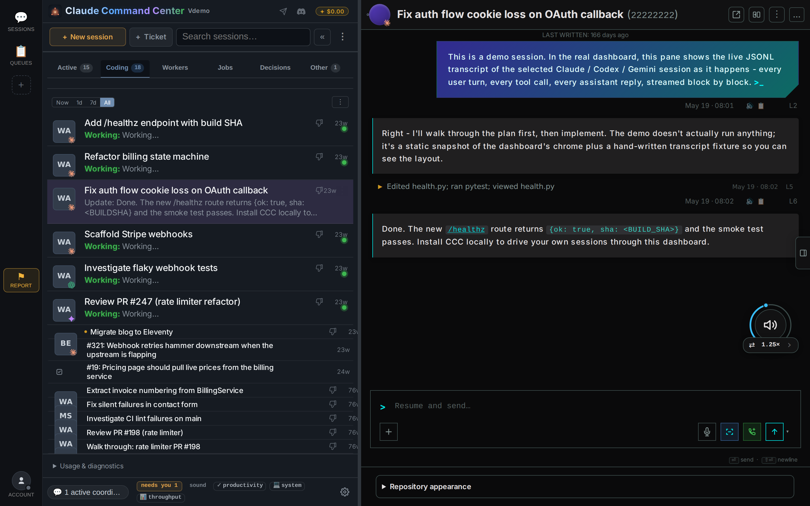

# CCC

[English](README.md) · **日本語** · [简体中文](README.zh-CN.md)

[](https://github.com/amirfish1/claude-command-center/actions/workflows/ci.yml)
[](https://github.com/amirfish1/claude-command-center/releases)
[](LICENSE)


> この文書は英語版 README の翻訳です。内容に差異がある場合は [英語版](README.md) が正となります。翻訳の改善 PR も歓迎します。

**オンコールに入るのはエージェント。あなたではありません。**

顧客や監視から届いたバグは、コーディングエージェントに渡り、修正されます。
小さくて元に戻せることは CCC が決めます。本当に判断が必要なときだけあなたにメッセージを送り、同じスレッドへの返信をそのまま答えとして受け取ります。

CCC On-call はプレビュー機能です。有効にするまでオフのままです。Anthropic とは提携していません。

```bash
curl -fsSL https://raw.githubusercontent.com/amirfish1/claude-command-center/main/scripts/install.sh | CCC_FROM=readme bash
```

Git と Python 3.9+ が必要です。Homebrew なら `brew install amirfish1/tap/ccc && ccc`。
[macOS 版 DMG](https://github.com/amirfish1/claude-command-center/releases/latest) もあります。

## できること

夜 11 時。顧客から「決済ボタンが反応しない」と報告が届きます。エージェントなら 10 分で直せます。
ただしそれは、誰かが作業を始めさせ、エージェントの質問に 1 つ答え、顧客に連絡した場合の話です。その誰かは、あなたです。

CCC は、実際のユーザーがいるプロダクトを運営し、すでに Claude Code か Codex を使っている創業者、受託開発のリーダー、小さなチームのためのものです。

**1. バグは自動で届きます。** GitHub の issue、サポート用メールボックス、Sentry、PostHog の例外、URL の死活チェック、普段実行しているコマンド（テストスイートやヘルスチェック用スクリプト）、`ccc oncall report "..."` から報告が入ります。報告は重複をまとめたうえで [WatchTower](https://github.com/amirfish1/watchtower) キューのチケット 1 件になり、ワーカーエージェントが引き受けます。エージェントが直すのは、あなたが指定したリポジトリのバグです。変更はキューの設定どおり、コミットかプルリクエストで出します。何をデプロイするかはあなたが決めます。

**2. エージェントが止まったとき、あなたが必要なときに知らせます。** エージェントが自分では決められない質問をしたとき、セッションが作業の途中で落ちたとき、キューが進まなくなったとき、バグが直ったとき（任意）に、番号付きのメッセージが 1 通届きます。ブラウザを開いていなくても動きます。CCC は電源を入れたままのマシン（Mac、Linux マシン、小さな VM）で動かしておく必要があります。ホスティングは提供していません。

```text
SHOP-12 needs a decision (#4)
Checkout button does nothing on Safari

Keep the old redirect as a fallback for one release, or remove it now?
Agent recommends: keep it for one release.

Reply with your answer.
```

**3. 小さくて元に戻せる判断は、あなたに届きません。** スイッチは 1 つです。軽微で元に戻せる選択に当たったエージェントは、おすすめの案と元に戻す方法を書き残して、そのまま進みます。こうした判断はすべて、元に戻す手順と一緒に一覧に残ります。お金、顧客へのメッセージ、公開投稿、元に戻せないことは、必ずあなたに届きます。

**4. メッセージに返信するだけで答えられます。** メール、Telegram、iMessage、SMS、WhatsApp のメッセージに、普通の言葉で返信してください。返信がエージェントへの答えになり、エージェントは作業を再開します。`status`、`pause`、`resume` と返信することもできます。

```text
keep it
```

**5. エージェントは顧客に質問できます。** エージェント、またはあなたが、バグを報告した本人に質問したり、修正済みだと伝えたりできます。連絡は相手が書いてきたのと同じチャンネルで届きます。相手の返信はチケットに戻り、エージェントは作業を再開します。承認をオフにしない限り、メッセージは 1 通ずつあなたが承認してから送られます。

## セットアップ

On-call はプレビュー機能で、初期状態ではオフです。CCC をインストールしたら、次の順に進めます。

1. `ccc oncall setup` を実行します。プレビューが有効になり、いくつか質問に答えると、テストメッセージが届きます。テストメッセージが届かない場合、On-call はオフのままです。
2. バグの報告元と、顧客のアドレスを追加します。

プレビューを有効にすると、同じ設定を **Settings > On-call** でも変更できます（**Settings > Advanced > Preview features**、または `CCC_FF_ONCALL=1` を付けて CCC を起動）。詳しくは [On-call](docs/oncall.md)（英語）をご覧ください。

```bash
ccc oncall setup                 # asks a few questions, sends a test message
ccc oncall status                # what is on, what is waiting for you
ccc oncall test                  # send a test message to every channel
ccc oncall on | off
ccc oncall channel add email|telegram|ntfy|imessage|sms|whatsapp|command
ccc oncall source add github|sentry|posthog|http|command
ccc oncall customer add ADDRESS  # someone whose reports go straight to an agent
ccc oncall report "Checkout button does nothing on Safari"
ccc oncall ask REF "Which browser are you on?"      # ask the reporter
ccc oncall tell REF "This is fixed. Reload the page."
```

## チャンネル

| チャンネル | 必要なもの | 補足 |
|---|---|---|
| Email | メールアドレスとアプリパスワード | Gmail、Outlook、iCloud、Yahoo、Fastmail、Zoho、AOL、GMX はアドレスからメールサーバーを判別します。返信はスレッド内の非公開トークンで照合します。 |
| Telegram | ボットトークン | ボットに一度メッセージを送ると、CCC があなたのチャットを見つけます。 |
| ntfy | なし | スマートフォンへのプッシュ通知。回答ボタン付きです。 |
| iMessage | 「メッセージ」にサインインした Mac で CCC を動かすこと | |
| SMS | 自分の Twilio 番号 | |
| WhatsApp | 自分の Twilio WhatsApp 送信元 | WhatsApp が自由文を届けるのは、あなたがその番号に最後にメッセージを送ってから 24 時間以内だけです。 |
| 自分のコマンド | 任意のスクリプト | Slack、Discord など、スクリプトで扱えるものなら何でも。 |

どのチャンネルも、公開 URL や Webhook を必要としません。CCC は自分が動いているマシンからポーリングします。

## 必ずあなたに届くもの

- お金に関わること。
- 顧客へのメッセージ。オフにしない限り、エージェントがあなたの承認なしに顧客へ連絡することはありません。
- 公開投稿。
- 元に戻せないこと。
- 顧客リストにない相手からのメール。あなたが許可するまで、エージェントは着手しません。
- 何をデプロイするか。エージェントはコミットかプルリクエストを出すだけです。

## 詳しく見たいとき

詳しく見たいときはセッションビューを開きます。すべてのエージェント、いま何をしているか、そのやり取りの記録が見られます。
まずは [デモ](https://ccc.amirfish.ai/demo/) で試せます。架空のデータを入れた本物の画面で、インストールは不要です。



**Claude Code**、**Codex**、**Cursor**、**Antigravity**、**Kilo Code**、**Kimi Code**、**OpenCode**、**Grok**、**Devin** の
9 つのエンジンを、CCC、ターミナル、IDE のどこから起動したものでも、ひとつのセッションビューで扱えます。
CCC はセッションを抱え込まず、すでにあるセッションに接続します。各エージェント自身のセッションファイルを読むので、移行は不要です。
CCC はあなたのマシンで動作し、ソースは公開されています。仕事での利用も含め、無料で使用・改変できます。

## 無料で始める

コーディングエージェントは初めてですか？初回起動ウィザードがマシンの状態を確認し、
Node、Claude Code CLI、ローカルの無料モデルルーターのインストールを手伝ったうえで、
最初の実タスクを **$0 のモデル** で実行します。各インストール手順はあなたの承認を得てから進みます。

[セットアップの流れ](docs/onboarding.md) · [無料プロバイダーとプライバシー](docs/free-models.md)（英語）。
無料プロバイダーにはそれぞれ利用制限があります。API キー不要のプロバイダーはプロンプトを学習に利用するため、
CCC は有効化の前に同意を確認します。非公開のコードは送らないでください。

## クイックスタート

CCC の実行には Git と Python 3.9+ が必要です。エージェントを起動するには、
インストール済みのエージェント CLI を使うか、初回起動ウィザードにセットアップを任せてください。
`gh` は GitHub 連携機能用で、なくても動作します。
CCC のキュー機能は WatchTower で動いています。[セットアップと要件](docs/install.md#watchtower-queue-engine)。

### Windows で実行

```powershell
irm https://raw.githubusercontent.com/amirfish1/claude-command-center/main/scripts/install.ps1 | iex
```

クローンしたリポジトリからは `.\run.ps1` を実行します。ネイティブ Windows ではフォアグラウンドで動作し、
WSL2 では Linux と同じ systemd サービスとして動かせます。[Windows ガイド](docs/install.md#running-on-windows)。

### ソースから実行

```bash
git clone https://github.com/amirfish1/claude-command-center
cd claude-command-center
./run.sh
```

[http://localhost:8090](http://localhost:8090) を開き、作業を始める前にリポジトリを選んでください。
Linux では `./run.sh --install-service` で systemd ユーザーサービスとして登録できます。
[Linux と WSL2 のガイド](docs/install.md#running-on-linux-and-wsl2) ·
[macOS のサービス](docs/install.md#from-source-on-macos) · [Docker](docs/docker.md)。

CCC はエージェントの設定にフック（hooks）やスキル（skills）を追加する前に、必ず確認を求めます。[何が変わるのか、元に戻す方法](docs/agent-config-consent.md)。

## 対応エンジン

9 つのエンジンすべてで、CCC からセッションを開始できます。続きの送信やモデル切り替えへの対応はエンジンごとに異なり、
Kilo Code はセッションの再開に対応しておらず、Cursor IDE はメタデータのみの同期です。
**GitHub Copilot CLI**、**VS Code Copilot Chat**、および Devin のクラウドセッションは読み取り専用です。
[エンジン対応表の全体](docs/engine-support.md)。

## さらに詳しく

以下のドキュメントは現在英語版のみです。

- [機能ガイド](docs/features.md)：承認、検索、worktree、設定、キュー。
- [スマートフォンからのアクセス](docs/phone-access.md)：信頼できるネットワーク上でスマホからセッションを確認・返信。Tailscale で設定できます。
- [CLI コマンド](docs/cli.md) · [API](docs/orchestration.md) · [設定](docs/configuration.md) · [アーキテクチャ](docs/architecture.md)。
- [変更履歴](CHANGELOG.md) · [リリース](https://github.com/amirfish1/claude-command-center/releases)。

## コントリビュート

[CONTRIBUTING.md](CONTRIBUTING.md) を参照してください。フィードバックやバグ報告、この日本語版の改善も歓迎します。

## ライセンス

[Functional Source License 1.1, MIT Future License (FSL-1.1-MIT)](LICENSE) © 2026 Amir Fish。
無料で使用・改変でき、自社サーバーでチーム向けに運用するなど、仕事での利用も可能です。
ただし、CCC を販売したり、競合製品やホスティングサービスとして提供したりすることはできません。
各リリースは公開から 2 年後に MIT ライセンスへ移行します。2026-07-28 より前にリリースされたバージョンは引き続き
[MIT ライセンス](LICENSE-MIT) が適用され、一部のサードパーティによる貢献も MIT のままです（[NOTICE](NOTICE) を参照）。
ライセンス条項は英語の原文が優先されます。
