# CCC

**English** · [日本語](README.ja.md) · [简体中文](README.zh-CN.md)

**Your agents are on call. You are not.**

Bugs from customers and from monitoring go to coding agents that fix them.
CCC decides the small reversible things, messages you when it needs a real decision, and takes your answer from the same thread.

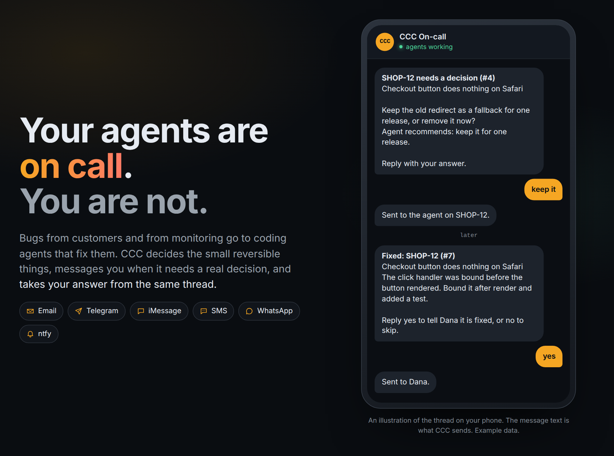

<sub>An illustration of the thread on your phone. The message text is what CCC sends. Example data.</sub>

CCC On-call is a preview. It is off until you turn it on. Not affiliated with Anthropic.

```bash
curl -fsSL https://raw.githubusercontent.com/amirfish1/claude-command-center/main/scripts/install.sh | CCC_FROM=readme bash
```

<sub>Needs curl, Git and Python 3.9+ (macOS or Linux; [Windows](#running-on-windows)). Opens http://localhost:8090 and asks before installing a background service. Sends one anonymous daily ping; `CCC_TELEMETRY_DISABLED=1` turns it off ([what it sends](docs/telemetry.md)).</sub>

Or `brew install amirfish1/tap/ccc && ccc`, or grab the [macOS DMG](https://github.com/amirfish1/claude-command-center/releases/latest).

[](https://github.com/amirfish1/claude-command-center/actions/workflows/ci.yml)
[](https://github.com/amirfish1/claude-command-center/releases)
[](https://github.com/amirfish1/claude-command-center/stargazers)
[](LICENSE)

[](https://discord.gg/aK325db94M)

## What it does

It is 11pm. A customer reports the checkout button is dead. The fix is ten minutes for an agent, but only if someone starts it, answers its one question and tells the customer. That someone is you.

CCC is for a founder, agency lead or small team that ships a product with real users and already uses Claude Code or Codex. CCC puts coding agents on call for your product.

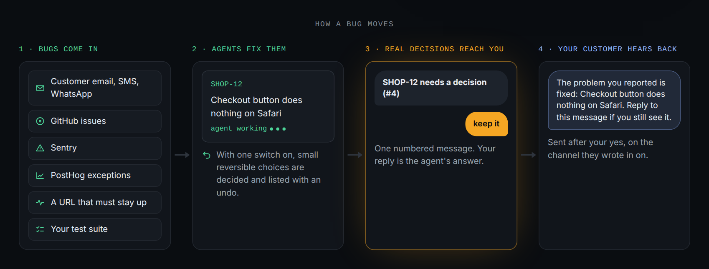

### One bug, five steps

The same bug with On-call turned on. Two messages reach you. You type three words.

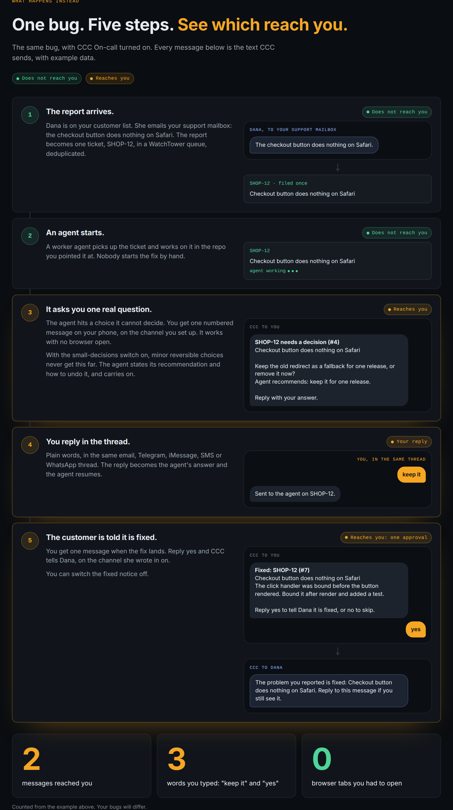

<sub>An illustration of the thread on your phone. The message text is what CCC sends. Example data.</sub>

**1. Bugs come in by themselves.** Reports arrive from GitHub issues, a support mailbox, Sentry, PostHog exceptions, a URL uptime check, any command you already run (a test suite, a health script), or `ccc oncall report "..."`. Each becomes one ticket in a [WatchTower](https://github.com/amirfish1/watchtower) queue, deduplicated, and a worker agent picks it up. Agents fix bugs in the repo you point them at. They open the change the way your queue is set up to (a commit or a pull request). You decide what deploys.

**2. You hear when an agent stops or needs you.** You get one numbered message when an agent asks a question it cannot decide, an agent session dies mid-task, a queue stops moving, or a bug is fixed (optional). It works with no browser open. CCC must be running on a machine that stays on: your Mac, a Linux box or a small VM. Nothing is hosted for you.

```text
SHOP-12 needs a decision (#4)
Checkout button does nothing on Safari

Keep the old redirect as a fallback for one release, or remove it now?
Agent recommends: keep it for one release.

Reply with your answer.
```

**3. Small reversible decisions do not reach you.** One switch. An agent that hits a minor, reversible choice states its recommendation and how to undo it, and carries on. Every such decision is listed with its undo. Money, messages to customers, public posts and anything that cannot be undone always come to you.

**4. Answer from the message.** Reply to the email, Telegram message, iMessage, SMS or WhatsApp message in plain words. The reply becomes the agent's answer and the agent resumes. You can also reply `status`, `pause` or `resume`.

```text
keep it
```

**5. Agents can ask your customer.** An agent, or you, asks the person who reported the bug a question, or tells them it is fixed, on the channel they wrote in on. Their reply goes back onto the ticket and the agent resumes. You approve each message first unless you turn approval off.

```text
An agent wants to ask Dana (dana@example.com) about SHOP-12 (#6):

Which Safari version are you on, and does it happen in a private window?

Reply yes to send, no to drop, or reply with your own wording.
```

Mail from someone not on your customer list waits for your go-ahead before an agent works on it:

```text
New report from dana@example.com (#5)
Checkout button does nothing on Safari

Reply go to have an agent work on it, or no to drop it.
```

And when the bug is fixed:

```text
Fixed: SHOP-12 (#7)
Checkout button does nothing on Safari
The click handler was bound before the button rendered. Bound it after render and added a test.

Reply yes to tell Dana it is fixed, or no to skip.
```

## Set it up

On-call is a preview and it is off by default. Install CCC with the line above, then:

1. Run `ccc oncall setup`. It turns the preview on, asks a few questions and sends you a test message. If the test message does not arrive, On-call stays off.
2. Add where bugs come from and who your customers are.

The same settings are in **Settings > On-call** once the preview is on (**Settings > Advanced > Preview features**, or start CCC with `CCC_FF_ONCALL=1`). Full guide: [On-call](docs/oncall.md).

```bash
ccc oncall setup                 # turns the preview on, asks a few questions, sends a test message
ccc oncall status                # what is on, what is waiting for you
ccc oncall test                  # send a test message to every channel
ccc oncall on | off
ccc oncall channel add email|telegram|ntfy|imessage|sms|whatsapp|command
ccc oncall source add github|sentry|posthog|http|command
ccc oncall customer add ADDRESS  # someone whose reports go straight to an agent
ccc oncall report "Checkout button does nothing on Safari"
ccc oncall ask REF "Which browser are you on?"      # ask the reporter
ccc oncall tell REF "This is fixed. Reload the page."
```

## Channels

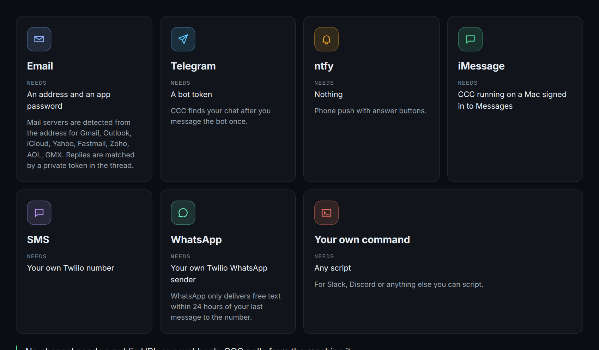

| Channel | Needs | Notes |
|---|---|---|
| Email | An address and an app password | Mail servers are detected from the address for Gmail, Outlook, iCloud, Yahoo, Fastmail, Zoho, AOL, GMX. Replies are matched by a private token in the thread. |
| Telegram | A bot token | CCC finds your chat after you message the bot once. |
| ntfy | Nothing | Phone push with answer buttons. |
| iMessage | CCC running on a Mac signed in to Messages | |
| SMS | Your own Twilio number | |
| WhatsApp | Your own Twilio WhatsApp sender | WhatsApp only delivers free text within 24 hours of your last message to the number. |
| Your own command | Any script | For Slack, Discord or anything else you can script. |

No channel needs a public URL or a webhook. CCC polls from the machine it runs on.

## What always comes to you

- Money.
- Messages to customers. Agents never message a customer without your approval unless you turn that off.
- Public posts.
- Anything that cannot be undone.
- Mail from someone not on your customer list. It waits for your go-ahead before an agent works on it.
- What deploys. Agents open a commit or a pull request. You decide what ships.

## When you want detail

The session view is where you look when you want detail: every agent, what it is doing, its transcript. Want to look first? The [live demo](https://ccc.amirfish.ai/demo/) runs in your browser with fake data, no install.

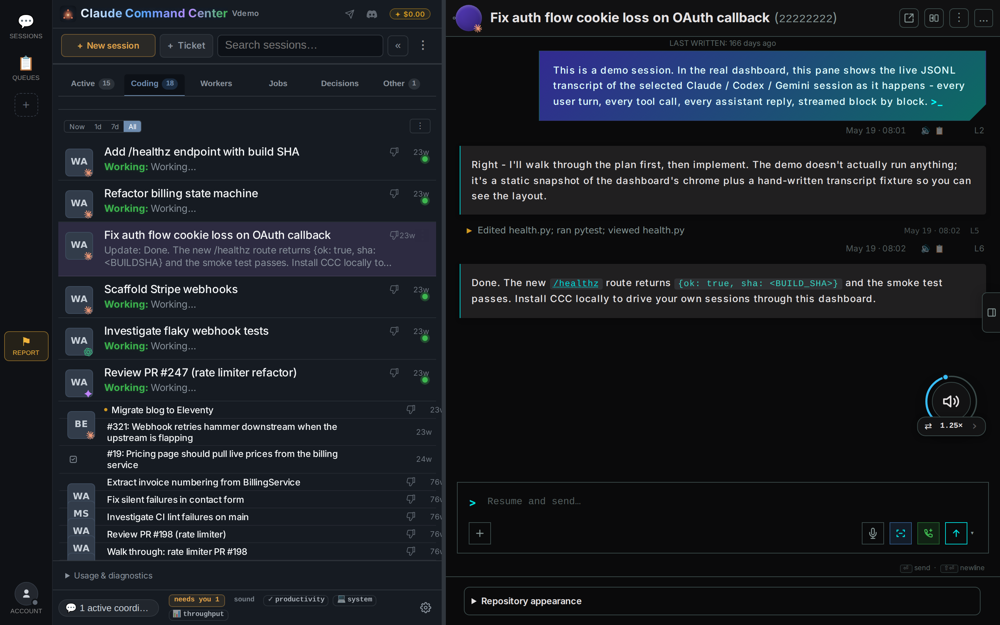

<sub>The session view on demo data: the session list on the left, one transcript open on the right.</sub>

### Works with the agents you already use

  
  
  

Nine engines in one session view, however you launched them: from CCC, a terminal, or an IDE.
CCC attaches to sessions you already have instead of owning them. It reads each agent's own session files, so there is nothing to wrap or migrate.
Close the CCC page and your agents keep running. [How attachment works](docs/session-attach.md).
It runs on your machine and it is source-available: no account, free to use at work ([FSL-1.1-MIT](LICENSE)).

### When an agent stops to ask, you see it

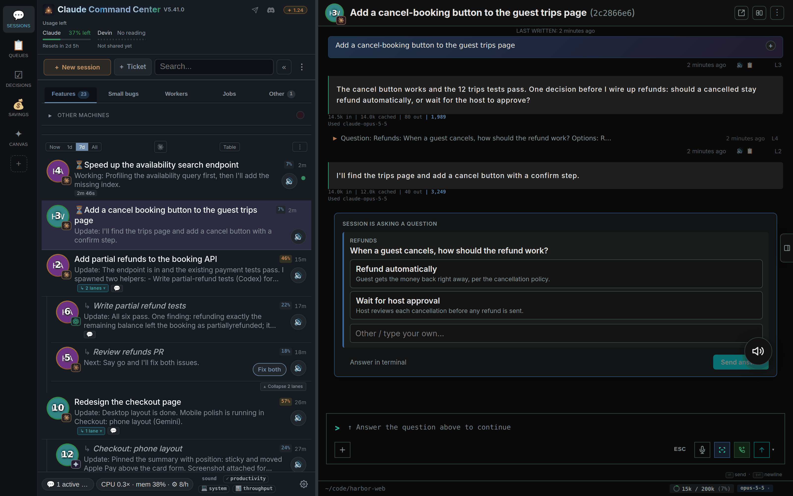

### When you hit your usage limit, the fleet keeps going

<a href="docs/product-story/assets/video/V-20-limit-hit-16x9.mp4">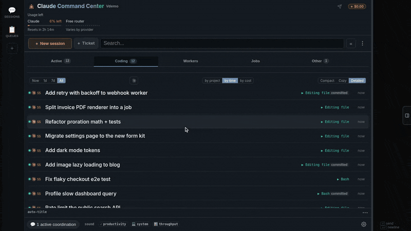</a>

## Start free

New to coding agents? The first-run wizard checks your machine, helps install
Node, the Claude Code CLI, and a local free-model router, then runs your first
real task on a **$0 model**. You approve each install step. It ends with the
honest math: *"This run cost $0. At API prices it would have cost $X."*

[Walk through setup](docs/onboarding.md) · [Free providers and privacy](docs/free-models.md).
Free providers have their own limits. The keyless provider logs prompts for
training; CCC asks for consent before enabling it. Do not send it private code.

**Already use Claude Code?** Your past sessions are in the session view when it opens, and anything you run with `claude` shows up by itself.

## See CCC at work

<table>
<tr>
<td width="50%" valign="middle"><h3>One view, nine engines</h3>See sessions you started in a terminal or from CCC. Each agent's own files keep the list up to date.</td>
<td width="50%">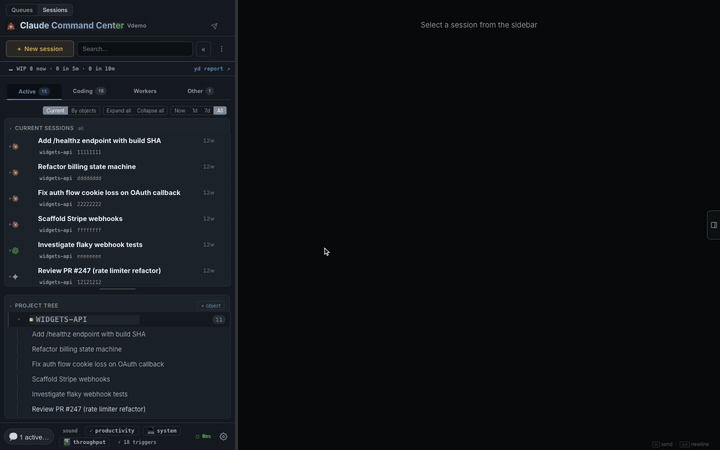</td>
</tr>
<tr>
<td width="50%">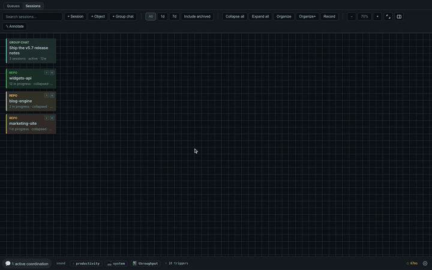</td>
<td width="50%" valign="middle"><h3>Flow canvas &amp; Project tree</h3>Group sessions by the work they belong to. Keep your live sessions next to a map of your projects.</td>
</tr>
<tr>
<td width="50%" valign="middle"><h3>Split conversations</h3>Drag a session onto the edge of an open conversation to read two agents side by side. Each has its own input bar.</td>
<td width="50%">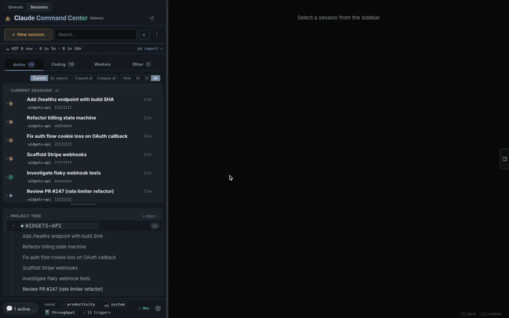</td>
</tr>
<tr>
<td width="50%">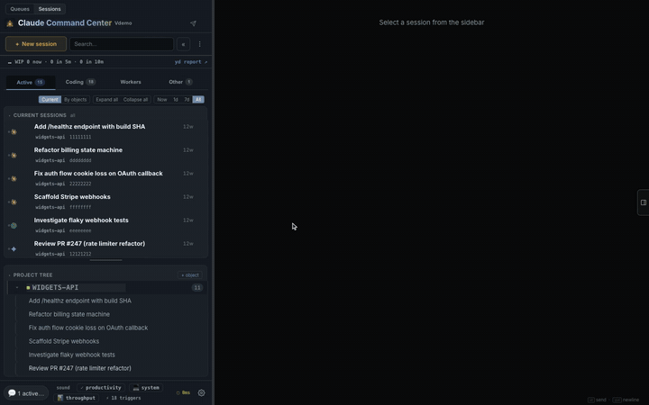</td>
<td width="50%" valign="middle"><h3>Find anything, from any session</h3>Search your session history without extra setup. An optional semantic mode helps when you cannot remember the exact words.</td>
</tr>
<tr>
<td width="50%" valign="middle"><h3>Sessions that coordinate without you</h3>Post once to a group chat and every participant gets the message. No copying answers between terminals.</td>
<td width="50%">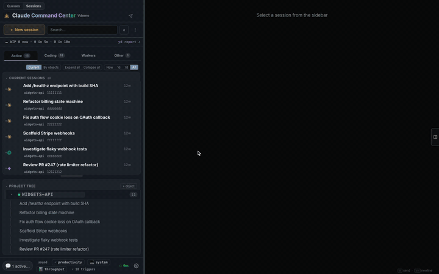</td>
</tr>
<tr>
<td width="50%">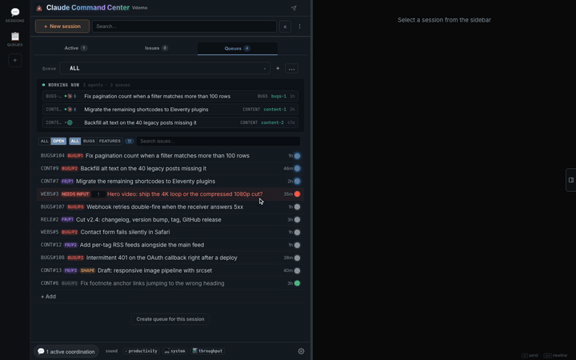</td>
<td width="50%" valign="middle"><h3>Durable queues, one inbox</h3>Put work in a <a href="https://github.com/amirfish1/watchtower">WatchTower</a> queue. Tickets survive closed sessions, and workers can pick them up in parallel.</td>
</tr>
<tr>
<td width="50%" valign="middle"><h3>Workers that specialize over time</h3>Workers read their queue's shared learnings before a task and write back afterwards, so the next worker has that experience.</td>
<td width="50%">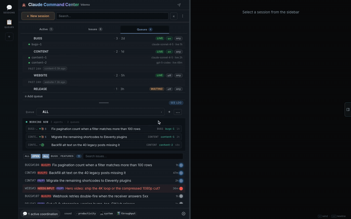</td>
</tr>
<tr>
<td width="50%" align="center">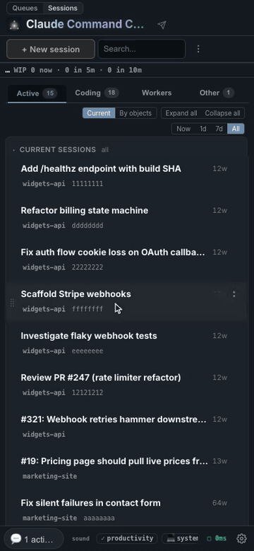</td>
<td width="50%" valign="middle"><h3>Work from anywhere</h3>Monitor sessions and reply from your phone on a trusted network. CCC stays local by default. <b>Settings &gt; Phone access</b> guides you through Tailscale. <a href="docs/phone-access.md">Phone setup</a>.</td>
</tr>
</table>

All captures use seeded demo data. [Full feature guide](docs/features.md).

## Quickstart

You need Git and Python 3.9+ to run CCC, plus curl for the install line above.
On Ubuntu or Debian: `sudo apt-get install git python3 curl ca-certificates`.
To launch agents, use an installed agent CLI or let the first-run wizard help set one up. `gh` is
optional for GitHub features.

Prefer Python tools? [Build and run a wheel with uvx or pipx](docs/install.md#python-runners-preview).
This is a source-build preview, not a PyPI release.

### WatchTower comes with it

WatchTower powers CCC's queues. See [setup and requirements](docs/install.md#watchtower-queue-engine).

### Running on Windows

```powershell
irm https://raw.githubusercontent.com/amirfish1/claude-command-center/main/scripts/install.ps1 | iex
```

From a clone, run `.\run.ps1`. Native Windows runs in the foreground; WSL2
supports the Linux systemd service route. [Windows guide](docs/install.md#running-on-windows).

### From source

```bash
git clone https://github.com/amirfish1/claude-command-center
cd claude-command-center
./run.sh
```

Open [http://localhost:8090](http://localhost:8090), then pick a repo before
starting work. Keep the terminal open for a foreground launch.

### Running on Linux

Use `./run.sh` in the foreground or `./run.sh --install-service` for a systemd
user service. [Linux and WSL2 guide](docs/install.md#running-on-linux-and-wsl2) ·
[macOS services](docs/install.md#from-source-on-macos) · [Docker](docs/docker.md).

### Your agent config

CCC includes [question numbering and tagging guidance](docs/user-question-tags.md)
for sessions it starts. It asks before adding that guidance, hooks or skills to
your global agent config.
You can skip them, review the diff, or remove them later in Settings.
[What changes, and how to undo it](docs/agent-config-consent.md).

## Engine support

All nine engines can start sessions from CCC. Follow-up and model controls
vary; Kilo Code has no resume, and Cursor IDE sync is metadata-only.
**GitHub Copilot CLI** and **VS Code Copilot Chat** are read-only,
as are Devin cloud sessions. [Full engine support matrix](docs/engine-support.md).

## Share your fleet

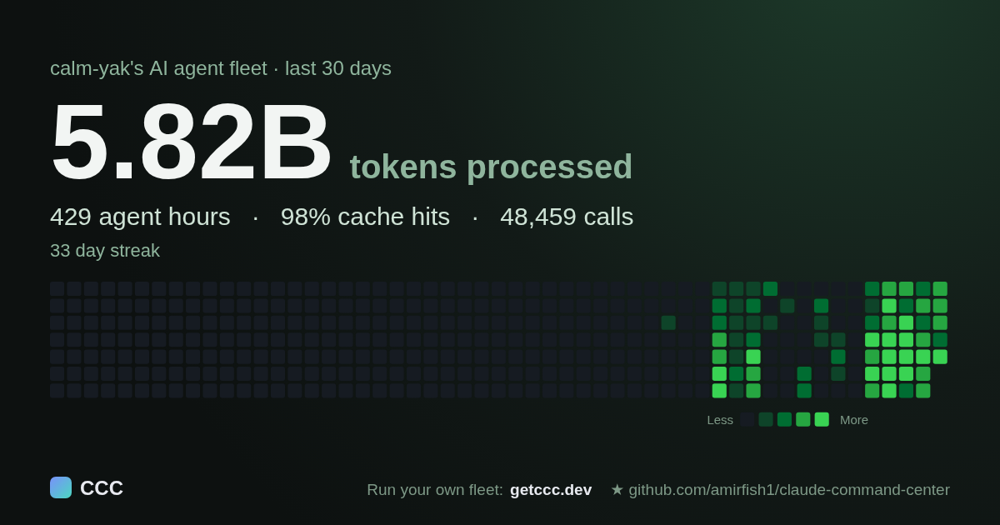

<sub>A real share card from one of the maintainer's machines. Yours comes from the throughput page: totals only, no prompts, code, or project names.</sub>

### Share a run

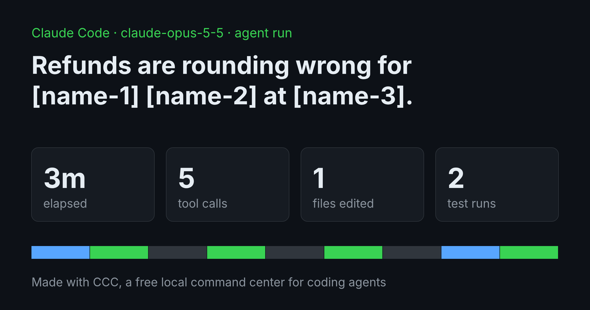

<sub>Demo data. Open a session's menu and pick **Share this run**, or use `ccc share <session>`. You get a redacted replay page or image as a file; nothing is uploaded. [What is kept and hidden](docs/sharing.md).</sub>

Built something with it? [](docs/sharing.md#the-badge)

## Recent

See [CHANGELOG.md](CHANGELOG.md) and [releases](https://github.com/amirfish1/claude-command-center/releases).
Choose **Watch > Releases** on GitHub for update notifications.

## Docs

- [Full feature guide](docs/features.md) · [Comparisons and scope](docs/features.md#how-it-compares) · [Free models](docs/free-models.md) · [Phone access](docs/phone-access.md)
- [Codex workspace](docs/codex-workspace.md): shared transcripts, live turns, desktop-owned tasks
- [Bring your own key (BYOK) and Vault](docs/byok-and-vault.md) · [other secrets](docs/byok-and-vault.md#vault-any-other-secret) · [credential requests](docs/credential-broker.md) when an agent needs a password, token or one-time code
- [Share a run](docs/sharing.md): redacted replay pages, stats cards and the README badge
- [Decision Inbox](docs/decision-inbox.md): choose the next step for stalled work
- [Throughput usage database](docs/usage-db.md) and cost comparisons
- Agents working together: [CLI](docs/cli.md) · [spawn, send, and ask APIs](docs/orchestration.md) · [12-skill pack](skills/README.md). Usage integrations read `GET /api/usage/current`
- [Skill integrations](docs/features.md#agents-working-together) · [installed-pack inventory](docs/skills-ecosystem-inventory.md) · [Cookbook: wire your own app into CCC](cookbook/README.md)
- [Architecture](docs/architecture.md) · [Configuration](docs/configuration.md) · [Shared-clone Git guard](docs/shared-clone-guard.md)
- Roadmap: see [Features](docs/features.md) and [Engine support](docs/engine-support.md); request improvements in [GitHub issues](https://github.com/amirfish1/claude-command-center/issues)

## Community

Join the [Discord server](https://discord.gg/aK325db94M) (`#general-fleet`, `#bugs-and-ideas`, `#ship-log`) or browse [GitHub Discussions](docs/community.md).

## Contributing

See [CONTRIBUTING.md](CONTRIBUTING.md). Feedback and bug reports are welcome.

<!-- star-history:start -->
<picture>
  <source media="(prefers-color-scheme: dark)" srcset="assets/star-history/star-history-dark.svg">
  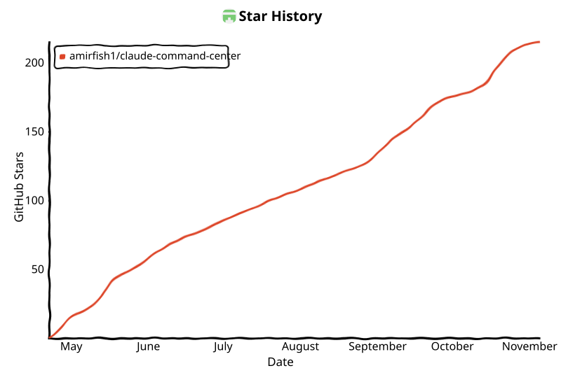
</picture>
<!-- star-history:end -->

## License

[Functional Source License 1.1, MIT Future License (FSL-1.1-MIT)](LICENSE) © 2026
Amir Fish. Free to use, modify, and run at work, including on your own servers
for your team. You may not sell CCC or offer it as a competing product or hosted
service. Each release becomes MIT two years after it ships. Versions released
before 2026-07-28 remain under the [MIT License](LICENSE-MIT); some third-party
contributions stay MIT (see [NOTICE](NOTICE)).

## Acknowledgments

Built on [Claude Code](https://docs.claude.com/en/docs/claude-code).
The `gh` and Vercel CLIs provide optional integrations.
