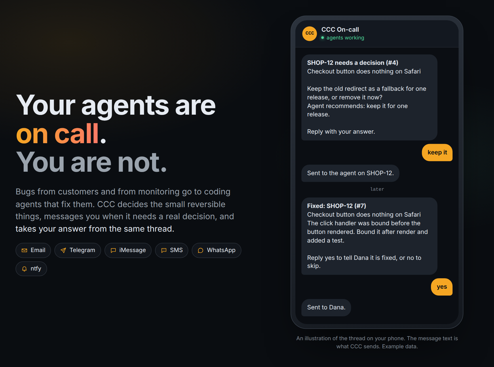
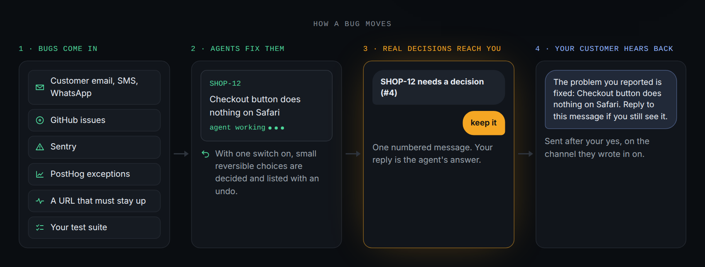
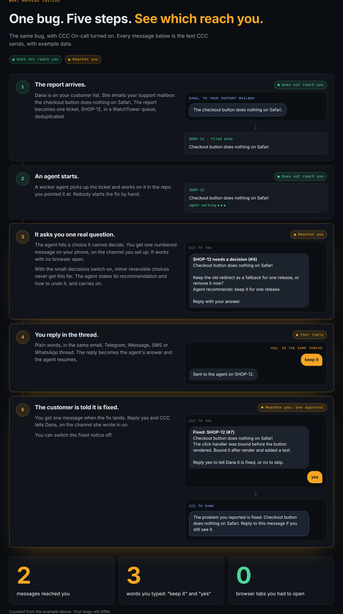
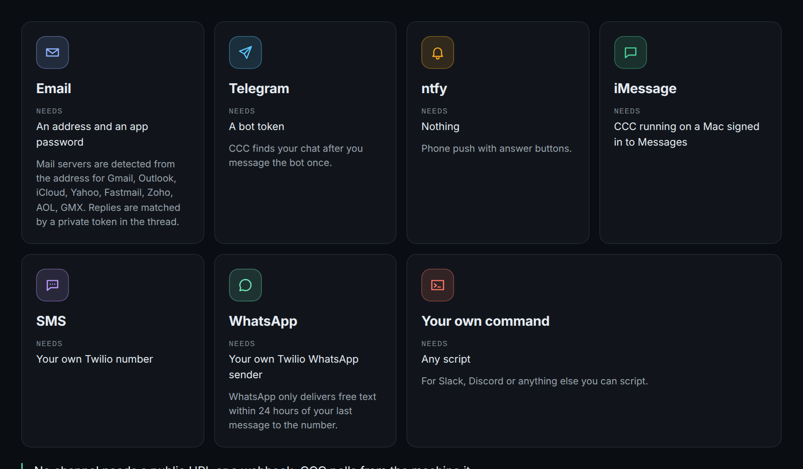
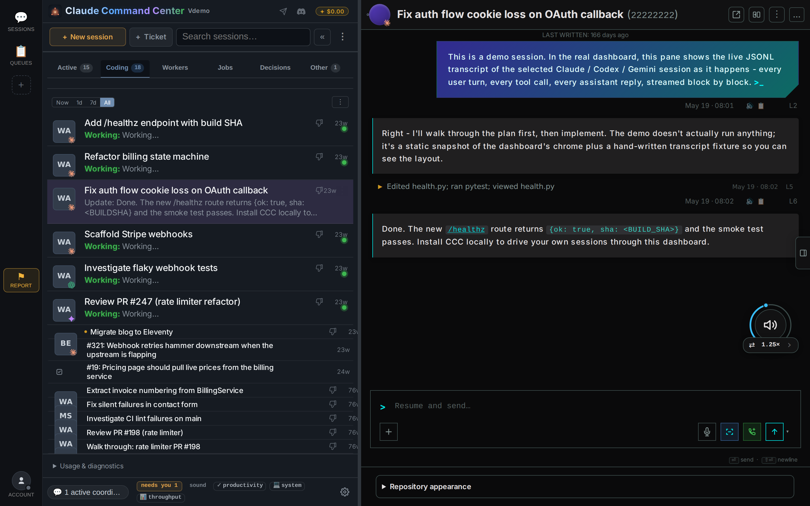

# CCC

[English](README.md) · [日本語](README.ja.md) · **简体中文**

[](https://github.com/amirfish1/claude-command-center/actions/workflows/ci.yml)
[](https://github.com/amirfish1/claude-command-center/releases)
[](LICENSE)


> 本文由英文版 README 翻译而来，内容以 [英文版](README.md) 为准。欢迎提 PR 改进译文。

**值班的是你的智能体，不是你。**

客户和监控报来的 bug，会交给编程智能体去修。
小而可撤销的事由 CCC 决定。真正需要你拍板时，它给你发消息，并从同一个对话里接收你的回复。



<sub>手机对话的示意图。消息文字是 CCC 实际发送的内容，数据为示例。</sub>

CCC On-call 是预览功能，默认关闭，需要你手动开启。本项目与 Anthropic 无关联。

```bash
curl -fsSL https://raw.githubusercontent.com/amirfish1/claude-command-center/main/scripts/install.sh | CCC_FROM=readme bash
```

需要 Git 和 Python 3.9+。也可以用 Homebrew：`brew install amirfish1/tap/ccc && ccc`，
或下载 [macOS DMG](https://github.com/amirfish1/claude-command-center/releases/latest)。

## 它做什么

晚上 11 点，客户反馈结账按钮点了没反应。智能体十分钟就能修好，前提是有人启动它、回答它的一个问题、再通知客户。这个人就是你。

CCC 面向这样的人：产品已有真实用户，并且已经在用 Claude Code 或 Codex 的创始人、外包团队负责人和小团队。



### 一个 bug，五步

开启 On-call 后的同一个 bug。到你手上的消息有两条，你一共打了三个词。



<sub>手机对话的示意图。消息文字是 CCC 实际发送的内容，数据为示例。</sub>

**1. bug 自己进来。** 来源包括 GitHub issue、客服邮箱、Sentry、PostHog 异常、URL 可用性检查、你本来就在跑的任何命令（测试套件、健康检查脚本），以及 `ccc oncall report "..."`。每条报告去重后成为 [WatchTower](https://github.com/amirfish1/watchtower) 队列里的一张工单，由一个工作智能体接手。智能体只修你指定仓库里的 bug，并按队列的设置提交改动（一次提交或一个 pull request）。部署什么由你决定。

**2. 智能体停下或需要你时，你会收到通知。** 智能体遇到自己决定不了的问题、会话在任务中途挂掉、队列不再推进、bug 修好（可选）时，你会收到一条带编号的消息。不用开着浏览器。CCC 必须运行在一台一直开着的机器上：你的 Mac、一台 Linux 机器或一台小型 VM。我们不提供托管。

```text
SHOP-12 needs a decision (#4)
Checkout button does nothing on Safari

Keep the old redirect as a fallback for one release, or remove it now?
Agent recommends: keep it for one release.

Reply with your answer.
```

**3. 小而可撤销的决定不来打扰你。** 一个开关。智能体遇到次要、可撤销的选择时，写明它的建议和撤销方法，然后继续干活。每个这样的决定都会连同撤销方法列出来。涉及钱、发给客户的消息、公开发布的内容，以及任何无法撤销的事，一律交给你。

**4. 直接回复消息就是回答。** 用平常的话回复那封邮件，或那条 Telegram、iMessage、短信、WhatsApp 消息。你的回复就是给智能体的答案，它随即继续工作。也可以回复 `status`、`pause`、`resume`。

```text
keep it
```

**5. 智能体可以向你的客户提问。** 智能体或你自己，可以在对方来信的渠道上向报告 bug 的人提问，或告诉对方已经修好。对方的回复会回到工单上，智能体继续工作。除非你关闭审批，每条消息都要先经你批准。

## 开始设置

On-call 是预览功能，默认关闭。装好 CCC 后：

1. 运行 `ccc oncall setup`。它会开启预览，问几个问题，并给你发一条测试消息。测试消息没有送达时，On-call 保持关闭。
2. 添加 bug 的来源和你的客户地址。

预览开启后，同样的设置也在 **Settings > On-call** 里（**Settings > Advanced > Preview features**，或带上 `CCC_FF_ONCALL=1` 启动 CCC）。完整说明见 [On-call](docs/oncall.md)（英文）。

```bash
ccc oncall setup                 # asks a few questions, sends a test message
ccc oncall status                # what is on, what is waiting for you
ccc oncall test                  # send a test message to every channel
ccc oncall on | off
ccc oncall channel add email|telegram|ntfy|imessage|sms|whatsapp|command
ccc oncall source add github|sentry|posthog|http|command
ccc oncall customer add ADDRESS  # someone whose reports go straight to an agent
ccc oncall report "Checkout button does nothing on Safari"
ccc oncall ask REF "Which browser are you on?"      # ask the reporter
ccc oncall tell REF "This is fixed. Reload the page."
```

## 渠道



| 渠道 | 需要 | 说明 |
|---|---|---|
| Email | 一个邮箱地址和应用专用密码 | Gmail、Outlook、iCloud、Yahoo、Fastmail、Zoho、AOL、GMX 的邮件服务器会根据地址自动识别。回复靠邮件线程里的私有令牌匹配。 |
| Telegram | 一个 bot token | 你给 bot 发过一条消息后，CCC 就能找到你的对话。 |
| ntfy | 无 | 手机推送，带回答按钮。 |
| iMessage | CCC 运行在一台已登录“信息”的 Mac 上 | |
| SMS | 你自己的 Twilio 号码 | |
| WhatsApp | 你自己的 Twilio WhatsApp 发送方 | 只有在你最近一次给该号码发消息后的 24 小时内，WhatsApp 才会投递自由文本。 |
| 你自己的命令 | 任意脚本 | 用于 Slack、Discord，或任何你能用脚本接入的工具。 |

所有渠道都不需要公网 URL 或 webhook。CCC 从它所在的机器上轮询。

## 一定会交给你的事

- 钱。
- 发给客户的消息。除非你关闭审批，智能体不会未经你批准就联系客户。
- 公开发布的内容。
- 任何无法撤销的事。
- 不在你客户名单上的人发来的邮件。你点头之后，智能体才会处理。
- 部署什么。智能体只提交改动或开 pull request。

## 想看细节的时候

想看细节，就打开会话视图：每个智能体、它正在做什么、它的对话记录。
想先看看？打开 [演示](https://ccc.amirfish.ai/demo/)：完整的界面，填充的是虚构数据，无需安装。



**Claude Code**、**Codex**、**Cursor**、**Antigravity**、**Kilo Code**、**Kimi Code**、**OpenCode**、**Grok** 和 **Devin**，
九种引擎的会话都在同一个会话视图里，无论是从 CCC、终端还是 IDE 启动的。
CCC 接入你已有的会话，而不是接管它们。它读取各智能体自己的会话文件，无需迁移。
CCC 运行在你自己的机器上，源码公开，个人和公司都可以免费使用和修改。

## 免费上手

第一次用编程智能体？首次运行向导会检查你的电脑，帮你装好 Node、Claude Code CLI
和一个本地免费模型路由，然后用 **$0 的模型** 跑完你的第一个真实任务。每一步安装都需要你确认。

[安装向导说明](docs/onboarding.md) · [免费模型与隐私](docs/free-models.md)（英文）。
免费服务商各有用量限制。其中免密钥的服务商会把提示词用于训练，CCC 启用它之前会先征得你的同意。
请不要把私有代码发给它。

## 国产模型：GLM、Kimi、DeepSeek、通义千问、MiniMax

CCC 内置了五家国产模型的预设：**智谱 GLM**、**Kimi（月之暗面）**、**DeepSeek**、
**通义千问 Qwen（阿里云百炼）** 和 **MiniMax**。除 DeepSeek 只有一个通用端点外，
每家都分国际站和国内站两个端点，选你注册 API 密钥的那个区域即可。
在 **设置 > 免费模型（Settings > Free models）** 或密钥向导里选择服务商、填入密钥，就能直接用这些模型启动 Claude 会话。

- 这些是 **付费** 模型，按各家官方价格计费，不走 CCC 的免费路由。
- 密钥只保存在 CCC 的本地密钥库里；提示词和代码会直接发给你选的服务商。
- 区域要对应：国内站的密钥填国内端点，国际站的密钥填国际端点。
  Kimi Code 订阅密钥、阿里云 Coding Plan 密钥不能用在这里。

更多细节见 [国产模型预设说明](docs/byok-and-vault.md#paid-key-presets-glm-kimi-deepseek-qwen-minimax)（英文）。

## 快速开始

运行 CCC 需要 Git 和 Python 3.9+。要启动智能体，可以用你已经装好的智能体 CLI，
也可以让首次运行向导帮你装一个。`gh` 是可选的，用于 GitHub 相关功能。
CCC 的任务队列由 WatchTower 驱动。见 [安装与要求](docs/install.md#watchtower-queue-engine)。

### 在 Windows 上运行

```powershell
irm https://raw.githubusercontent.com/amirfish1/claude-command-center/main/scripts/install.ps1 | iex
```

从源码目录运行则执行 `.\run.ps1`。原生 Windows 在前台运行；WSL2 下可以用 Linux 的
systemd 服务方式。[Windows 指南](docs/install.md#running-on-windows)。

### 从源码运行

```bash
git clone https://github.com/amirfish1/claude-command-center
cd claude-command-center
./run.sh
```

打开 [http://localhost:8090](http://localhost:8090)，先选一个代码仓库再开始工作。
在 Linux 上可以用 `./run.sh --install-service` 安装为 systemd 用户服务。
[Linux 与 WSL2 指南](docs/install.md#running-on-linux-and-wsl2) ·
[macOS 服务](docs/install.md#from-source-on-macos) · [Docker](docs/docker.md)。

CCC 在智能体配置里注册钩子（hooks）或安装技能（skills）之前都会先问你。[会改什么，以及如何撤销](docs/agent-config-consent.md)。

## 引擎支持

九种引擎都能从 CCC 发起会话。续聊和模型切换的支持程度各不相同：Kilo Code 不支持恢复会话，
Cursor IDE 只同步元数据。**GitHub Copilot CLI**、**VS Code Copilot Chat**
以及 Devin 云端会话为只读。[完整的引擎支持表](docs/engine-support.md)。

## 了解更多

以下文档目前只有英文版：

- [功能指南](docs/features.md)：审批、搜索、worktree、设置和队列。
- [手机访问](docs/phone-access.md)：在可信网络里用手机查看会话并回复，可通过 Tailscale 设置。
- [CLI 命令](docs/cli.md) · [API](docs/orchestration.md) · [配置项](docs/configuration.md) · [架构](docs/architecture.md)。
- [更新日志](CHANGELOG.md) · [版本发布](https://github.com/amirfish1/claude-command-center/releases)。

## 参与贡献

见 [CONTRIBUTING.md](CONTRIBUTING.md)。欢迎反馈问题和提交 PR，包括改进这份中文文档。

## 许可证

[Functional Source License 1.1, MIT Future License (FSL-1.1-MIT)](LICENSE) © 2026 Amir Fish。
可以免费使用、修改，也可以在公司内部运行，包括部署在你自己的服务器上供团队使用。
但不得出售 CCC，也不得把它做成竞品或托管服务对外提供。每个版本发布满两年后转为 MIT 许可。
2026-07-28 之前发布的版本仍适用 [MIT 许可证](LICENSE-MIT)；部分第三方贡献保持 MIT（见 [NOTICE](NOTICE)）。
许可条款以英文原文为准。
