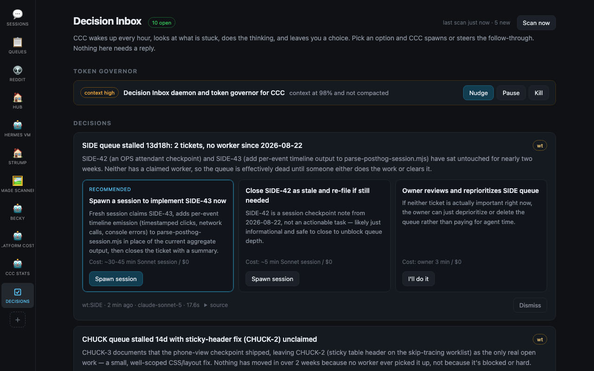

# Decision Inbox

[Back to the README](../README.md) · [Queues](QUEUES.md)

Open **Decisions** in the main navigation, app rail or `/decision-inbox.html`.
The [Owner questions table](decision-coverage.md#shared-request-view) shows
current local queue owner waits and explicitly promoted session questions.
Interactive questions stay in their sessions. Source answers remain disabled
by default, and incomplete source coverage is shown explicitly. Separately
[opted-in answer controls](decision-answers.md#dashboard-controls) distinguish
saving, sending and checking delivery.

The main Decisions tab stays inside the left-hand pane, preserving the
conversation pane and the usual sidebar width. Each queue question starts
with a ticket-reference chip: select it to open that ticket's context and
existing controls, then close the detail view to return to the same questions.
Links such as `/?ticket=EXAMPLE-1` also open the ticket directly.

**Reports and monitoring** retains scanner and tool reports. Scheduled scans
can create scripted health alerts or use an analyst model for suggested
follow-up cards; the sweep table records which path each decision used.

## Browsing decisions

Reports show ten compact rows per page. Expand a report to read its context,
created/updated timestamps, and options. Browse numbers reflect the current
filtered order; question references (such as Q123) and card IDs stay attached
to their original items. Search accepts those references, ticket names, and
text from the title or context. Filter by status or source and sort by creation
or update time. History includes all retained closed items.

Dates use Pacific time (PST/PDT). Feed refresh and
scanner time are shown separately: a successful scan does not prove that every
older decision still applies. Connection failures and overdue scans are visible.

## Why an item appeared

**Sweep history** shows one table row per added decision: its creation date/time
in Pacific time (`America/Los_Angeles`, automatically PST or PDT), clickable
reference and title, trigger, and LLM usage with its recorded or historical basis.
Pagination counts decisions, so a sweep adding several decisions creates several
rows. Empty script-only sweeps are hidden; an empty run that attempted an LLM
request remains visible as a **No decisions added** exception.

LLM usage is specific to each decision: a scripted health alert stays **No** even
when the same sweep used an LLM for another decision. New analyst records count
requests, retries and failures; unavailable historical usage is **Unknown**.
Existing Q-references are preserved. Persisted cards without a Q-reference use
stable local D-numbers, shared with the inbox list and searchable there.

`GET /api/decision-inbox/runs?offset=0&limit=10` preserves the unfiltered `runs`
and `total` plus sweep-level `activity_runs` and `activity_total`. It additionally
returns paginated `decision_rows` and `decision_total` for the compact table.
`hidden_count` counts omitted empty script-only sweeps. Malformed log lines are
counted in `invalid_records` and skipped. Limits are clamped to 1–100.

Q-tags identify questions written by agents in session transcripts. CCC bundles
the [question counter and tagging guidance](user-question-tags.md) by default.
A session question and an inbox card are separate records unless the card
explicitly carries that question's tag; numbering alone does not publish a card.

The [shadow coverage report](decision-coverage.md) compares current cached owner
questions and review gates with retained cards using stable source identities.
It does not change counts, merge questions or deliver answers.

On mobile, open **More → Decisions** in CCC. The More menu includes the same
app catalog as the desktop rail. Apps keep the bottom bar visible so you can
switch apps or return to sessions. Direct app links also open in this shell.

For remote mobile access, open the same remotely accessible inbox URL on the phone.
If that URL uses a private network connection, connect the phone to that network
first. Bookmark the page or add it to the phone's home screen. A localhost URL
points to the phone itself and cannot reach a dashboard on another computer.

## What it checks

- **Strategy board, optional:** a Markdown table with `Task | Status | ETA`
  columns. Blocked rows and open rows past their ETA become candidates.
- **WatchTower queues:** open tickets older than `wt_age_days`, with one
  `wt status --json` per run and one `wt ls` per surfaced queue.
- **Idle sessions:** live sessions idle longer than `idle_hours` with unfinished
  work, such as a pending tool or open goal.

The token governor checks live sessions in the same pass. It flags repeated
tool errors, 45 minutes of work without file edits, or 85% context usage with
no compaction. Choose **Nudge**, **Pause**, or **Kill** for a flagged session.

There are at most five new cards per run. A source with an open card, or one
decided or dismissed in the last week, is skipped.



## Configuration

Save settings in `~/.claude/command-center/decision-inbox.json`:

```json
{
  "strategy_board": "~/notes/Strategy Board.md",
  "interval_s": 3600,
  "max_cards_per_run": 5,
  "idle_hours": 2,
  "wt_age_days": 3,
  "model": "claude-sonnet-5",
  "spawn_cwd": "~/projects"
}
```

Set `CCC_DECISION_INBOX_DISABLED=1` to disable the loop. Cards and run history
live in `~/.claude/command-center/decision-inbox/`.

## File cards from another tool

A digest, monitor, or scheduled script can post to `POST /api/decision-inbox`
(alias `/api/decision-inbox/cards`):

```json
{
  "source": "digest",
  "source_id": "example:check",
  "title": "Review the stalled task",
  "detail": "The task needs a decision before it can continue.",
  "severity": "warn"
}
```

The reply is `{ok, card_id, deduped}`. Cards deduplicate by `source:source_id`,
so repeats keep one open card and count repeated reports. Pass `options` for
custom choices; omit them for acknowledge, spawn an investigator, or snooze
for 24 hours.

Read with `GET /api/decision-inbox`; actions use
`POST /api/decision-inbox/{run,decide,dismiss,governor}`.
