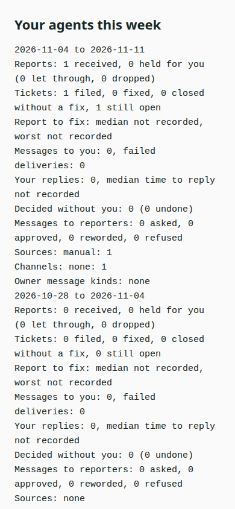

# See what your coding agents did this week

Run the weekly command against your running CCC dashboard. It works even when the On-call preview is off. Add --detail only when you want reporter addresses included.

```console checked
$ ccc oncall week
Reports: 1 received, 0 held for you (0 let through, 0 dropped)
```

## What you will see

You get two consecutive seven-day windows with reports, filed and fixed tickets, messages, replies, small decisions and fix times. Fixed counts mean WatchTower recorded a close with a commit.



## Limits

These counts do not prove deployment or correctness. Deleted history cannot be recovered. Provider acceptance does not prove a message was read. Incomplete WatchTower reads are marked. An empty installation will show zeros instead of the seeded example here.

## How we checked this

The exact command read one real report and its open ticket from an isolated queue. The image renders the actual command result, without command text. The seeded report is test data, not claimed production activity.

[Run the guide checks and see prerequisites](README.md#repeat-the-checks).
