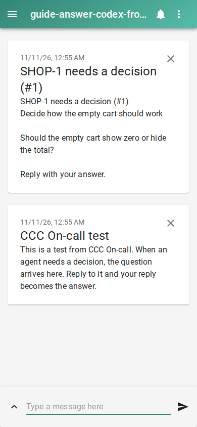

# Answer a Codex question from your phone

Try answering the demo question first: type `zero`, then `yes`. For your own agent sessions, set up a channel that receives replies.

```console checked
$ ccc oncall demo
Agent: Fix committed locally. The test passes.
```

Run these from the code folder you want agents to fix, with CCC and WatchTower installed and the dashboard running. Set `NTFY_SERVER` to your ntfy server URL and `NTFY_TOPIC` to a private topic name. Subscribe to that server and topic in the ntfy app. The setup command enables the preview and On-call; it also configures a worker for this folder.

```console checked
$ ccc oncall setup --yes --queue SHOP --repo . \
    --channel ntfy --set server="$NTFY_SERVER" \
    --set topic="$NTFY_TOPIC"
On-call is on: alerts and replies are enabled. Turn it off: ccc oncall off
```

## What you will see

When Codex ends a turn with an explicit question and stays idle for two minutes, On-call sends a numbered message. Publish `NUMBER your answer` to the same ntfy server on the topic whose name is your topic plus `-reply`. For example, reply `1 use blue`. The reply returns to the same session.



## Limits

The demo question is a ticket decision, not a live Codex session question. The paid session proof checks that separate path. Indirect questions can be missed. Questions from before enablement are ignored. Delivery to ntfy does not prove a phone displayed it. Normal Codex spawn does not offer tool permission prompts.

## How we checked this

The commands ran locally. The capture is an actual ntfy decision message from a seeded private ticket. A separate real Codex proof waited through the unchanged idle grace, received a local ntfy question, replied and checked the transcript for the answer.

[Run the guide checks and see prerequisites](README.md#repeat-the-checks).
