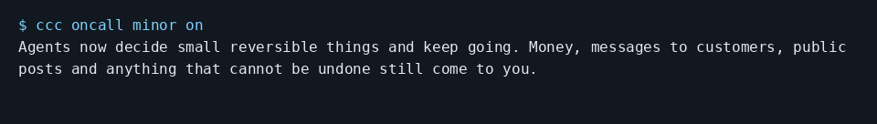

# What coding agents still need your approval for

Turn on small decisions without treating that switch as permission for consequential actions:

```console checked
$ ccc oncall minor on
Agents now decide small reversible things and keep going. Money, messages to customers, public posts and anything that cannot be undone still come to you.
```



Terminal capture rendered from the checked output above, with lines wrapped.

## What you will see

The CLI states the boundary: money, customer messages, public posts and irreversible actions still come to you. Minor policy is intended for reversible code changes.

## Limits

This switch is not an operating-system sandbox. Agents still have the tool access granted by their engine. Production changes are not minor decisions. Customer approval has a separate setting and can be disabled for non-GitHub messages. These policy boundaries have tests; this run does not attempt actual money movement or external sends.

[Guide setup and verification](README.md)
