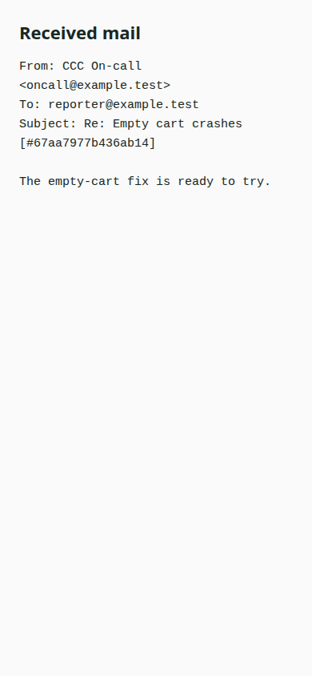

# Tell a customer their bug is fixed after you approve the message

Try the demo first and answer `zero`, then `yes` at the reporter notice. For your own setup, keep customer message approval enabled. Set `TICKET` to the reference of a report received from your customer, such as SHOP-1.

```console checked
$ ccc oncall demo
Agent: Fix committed locally. The test passes.
```

Run these from the code folder you want agents to fix, with CCC and WatchTower installed and the dashboard running. Set `NTFY_SERVER` to your ntfy server URL and `NTFY_TOPIC` to a private topic name. Subscribe to that server and topic in the ntfy app. The setup command enables the preview and On-call; it also configures a worker for this folder.

Save your mailbox app password in CCC Vault as `guide-mail` first. Set `MAIL_HOST`, `SMTP_PORT` and `IMAP_PORT` to your mail server values. This example uses implicit TLS for both protocols. Replace the three example.test addresses and the username with your own. The owner address receives alerts; the reporter address is a trusted customer.

```console checked
$ ccc oncall setup --yes --queue SHOP --repo . \
    --channel ntfy --set server="$NTFY_SERVER" \
    --set topic="$NTFY_TOPIC"
On-call is on: alerts and replies are enabled. Turn it off: ccc oncall off
```

```console checked
$ ccc oncall channel add email --intake \
    --set address=oncall@example.test --set owner=owner@example.test \
    --set username=oncall --set smtp_host="$MAIL_HOST" \
    --set smtp_port="$SMTP_PORT" --set smtp_security=tls \
    --set imap_host="$MAIL_HOST" --set imap_port="$IMAP_PORT" \
    --vault password=guide-mail
Added Email (owner@example.test). Sending and receiving both work.
```

```console checked
$ ccc oncall customer add reporter@example.test
Reports from reporter@example.test go straight to an agent.
```

```console checked
$ ccc oncall tell $TICKET "The empty-cart fix is ready to try."
Waiting for the owner to approve the message. The reply will land on the ticket.
```

## What you will see

You receive the draft first. Reply to its numbered alert with `yes`, `no`, or replacement wording. A yes sends on the channel the customer used. After a committed fix, On-call can also propose a fixed notice without a manual tell command.



## Limits

An owner-created report has no reporter address. Use a customer-originated ticket. Approval can be disabled for non-GitHub messages, so check that setting. GitHub comments always require approval. Sending a notice does not deploy the fix.

## How we checked this

All commands ran with a real local mailbox and queue. The checker verified no reporter mail before approval, published yes to local ntfy, and read the delivered message through IMAP. The image renders that received MIME email, not a composed draft. The paid email proof separately covers automatic fixing and its fixed notice.

[Run the guide checks and see prerequisites](README.md#repeat-the-checks).
