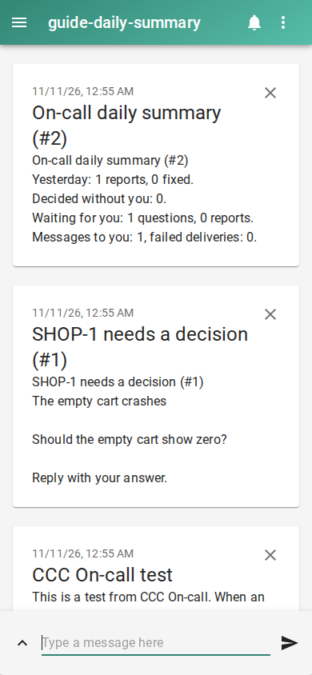

# Get a daily summary of what your coding agents did

Configure your notification channel, then enable the summary for 09:00 in the server’s local timezone. Set `CCC_SERVER` to your local dashboard URL, such as `http://127.0.0.1:8090`.

Run these from the code folder you want agents to fix, with CCC and WatchTower installed and the dashboard running. Set `NTFY_SERVER` to your ntfy server URL and `NTFY_TOPIC` to a private topic name. Subscribe to that server and topic in the ntfy app. The setup command enables the preview and On-call; it also configures a worker for this folder.

```console checked
$ ccc oncall setup --yes --queue SHOP --repo . \
    --channel ntfy --set server="$NTFY_SERVER" \
    --set topic="$NTFY_TOPIC"
On-call is on: alerts and replies are enabled. Turn it off: ccc oncall off
```

```console checked
$ curl --fail --silent --show-error -X POST "$CCC_SERVER/api/oncall/config" \
    -H "Origin: $CCC_SERVER" \
    -H "Content-Type: application/json" \
    --data '{"daily_summary":{"enabled":true,"time":"09:00"}}' | python3 -m json.tool
    "ok": true,
```

## What you will see

At or after the chosen time, the next On-call tick sends yesterday’s reports and fixes, decisions, pending questions and delivery counts. You can also set the switch and time in Settings > On-call.



## Limits

This adds a summary; it does not replace decision alerts with one message a day. Empty days send nothing. Quiet hours, pause and the hourly cap still apply. It does not catch up missed days. The schedule follows the server, not the phone’s timezone.

## How we checked this

The exact config request ran against the local On-call API. The checker advanced an isolated clock to the next 09:00 with a seeded waiting question, ran normal engine ticks, and verified exactly one summary reached real ntfy. The image is that received summary; the clock advance is a test fixture.

[Run the guide checks and see prerequisites](README.md#repeat-the-checks).
