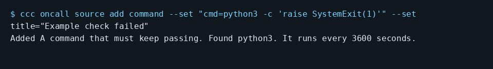

# Have a coding agent investigate a failing command

Add a command source that exits nonzero on failure. This example runs Python and fails deliberately. Use your test command in a real setup:

```console checked
$ ccc oncall source add command --set "cmd=python3 -c 'raise SystemExit(1)'" --set title="Example check failed"
Added A command that must keep passing. Found python3. It runs every 3600 seconds.
```



Terminal capture rendered from the checked output above, with lines wrapped.

## What you will see

The source is registered with an hourly interval. The checker also runs its probe and requires one finding, then no duplicate for the same failure episode.

## Limits

Adding the source checks that the executable exists, not that the command passes. Commands are split into arguments without a shell. Shell pipelines need an explicit shell. This run checks the real failing process and deduplication, not an agent fixing the failure. A successful check ends the episode so a later failure can create a new ticket.

[Guide setup and verification](README.md)
