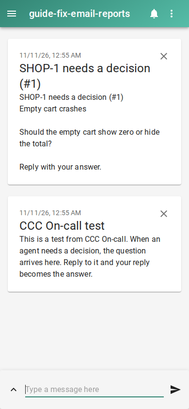

# Let an agent fix bugs reported by email

Try the email-to-fix scene first with the demo; answer `zero`, then `yes`. Then configure your own folder and mailbox.

```console checked
$ ccc oncall demo
Agent: Fix committed locally. The test passes.
```

Run these from the code folder you want agents to fix, with CCC and WatchTower installed and the dashboard running. Set `NTFY_SERVER` to your ntfy server URL and `NTFY_TOPIC` to a private topic name. Subscribe to that server and topic in the ntfy app. The setup command enables the preview and On-call; it also configures a worker for this folder.

Save your mailbox app password in CCC Vault as `guide-mail` first. Set `MAIL_HOST`, `SMTP_PORT` and `IMAP_PORT` to your mail server values. This example uses implicit TLS for both protocols. Replace the three example.test addresses and the username with your own. The owner address receives alerts; the reporter address is a trusted customer.

```console checked
$ ccc oncall setup --yes --queue SHOP --repo . \
    --channel ntfy --set server="$NTFY_SERVER" \
    --set topic="$NTFY_TOPIC"
On-call is on: alerts and replies are enabled. Turn it off: ccc oncall off
```

```console checked
$ ccc oncall channel add email --intake \
    --set address=oncall@example.test --set owner=owner@example.test \
    --set username=oncall --set smtp_host="$MAIL_HOST" \
    --set smtp_port="$SMTP_PORT" --set smtp_security=tls \
    --set imap_host="$MAIL_HOST" --set imap_port="$IMAP_PORT" \
    --vault password=guide-mail
Added Email (owner@example.test). Sending and receiving both work.
```

```console checked
$ ccc oncall customer add reporter@example.test
Reports from reporter@example.test go straight to an agent.
```

## What you will see

Send a bug report from the trusted reporter address to the intake address. It becomes a queue ticket. A running WatchTower worker can start the fixing agent. After a fix is recorded, you receive a proposed message to the reporter.



## Limits

You need a logged-in fixing agent and a running watcher. A filed ticket does not prove that a worker started. Unknown senders wait for approval. There is no automatic acknowledgement to the customer. Agents change the configured repository; deployment is separate.

## How we checked this

All four commands ran against a temporary queue, real local ntfy and a GreenMail TLS mailbox. A message from reporter@example.test became a ticket. The paid email proof separately required an automatic gpt-6.1-terra fix, unchanged tests, a commit and an approved notice in the reporter mailbox. Hosted email was not used.

[Run the guide checks and see prerequisites](README.md#repeat-the-checks).
