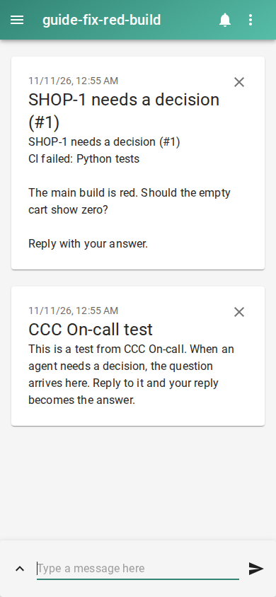

# Fix a red build on main automatically with a coding agent

Set `SOURCE_URL` to `https://api.github.com` for GitHub Actions. Replace the repository below, and run setup from its local checkout. A public repository can work without a token; private Actions need read access.

Run these from the code folder you want agents to fix, with CCC and WatchTower installed and the dashboard running. Set `NTFY_SERVER` to your ntfy server URL and `NTFY_TOPIC` to a private topic name. Subscribe to that server and topic in the ntfy app. The setup command enables the preview and On-call; it also configures a worker for this folder.

```console checked
$ ccc oncall setup --yes --queue SHOP --repo . \
    --channel ntfy --set server="$NTFY_SERVER" \
    --set topic="$NTFY_TOPIC"
On-call is on: alerts and replies are enabled. Turn it off: ccc oncall off
```

```console checked
$ ccc oncall source add ci --set repo=example-org/sample --set branches=main \
    --set base="$SOURCE_URL"
Added Failed CI runs. Actions connected. Existing red runs are left alone.
```

## What you will see

A new failed workflow on main becomes a ticket with the observed green and failing commits, failed job and available log excerpt. A later green run ends the incident. A committed fix is not announced as successful until CI is observed green.



## Limits

Existing red runs are skipped until recovery. The source polls one page and can miss failures hidden by a busy feed. It instructs agents not to weaken tests or workflow files; these instructions are not a sandbox. A green rerun alone is not called a code fix.

## How we checked this

The command check uses a local Actions API fixture. The separate local CI proof runs Gitea and act_runner, causes a real red build, dispatches gpt-6.1-terra, and checks the pushed fix, passing unchanged test and green run. No real GitHub account was contacted.

[Run the guide checks and see prerequisites](README.md#repeat-the-checks).
