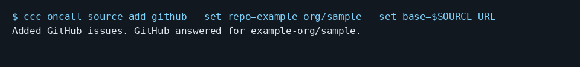

# Turn GitHub issues into work for a coding agent

Add a GitHub source for the repository containing the issues. This checked example connects to the checker’s local empty GitHub API fixture. SOURCE_URL is supplied by the checker, not a public service.

```console checked
$ ccc oncall source add github --set repo=example-org/sample --set base=$SOURCE_URL
Added GitHub issues. GitHub answered for example-org/sample.
```



Terminal capture rendered from the checked output above, with lines wrapped.

## What you will see

The real CLI accepts the repository and checks the local API. New open issues become queue work on later checks. Repository owners, members and collaborators are trusted; other authors wait for your go-ahead.

## Limits

This run verifies configuration against an empty local fixture, not GitHub intake followed by a fix. Unit tests cover new issues, deduplication and author approval. Existing issues are baselined unless backfill is requested. Only the newest 25 open issues are read per check.

## Not run here: needs a real account

In Settings > On-call, add GitHub and enter your repository. Use the default API address. Public intake needs no token. Private intake needs read access to issues. Messaging needs a saved user token with write access. Every issue comment waits for approval, even if other customer approvals are off. No GitHub account was contacted here.

[Guide setup and verification](README.md)
