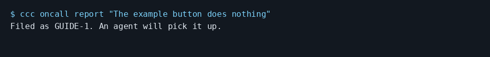

# Give a coding agent a bug to fix from your terminal

Use On-call report after configuring your code folder and queue:

```console checked
$ ccc oncall report "The example button does nothing"
Filed as GUIDE-1. An agent will pick it up.
```



Terminal capture rendered from the checked output above, with lines wrapped.

## What you will see

The command files a real ticket in the checker's isolated GUIDE queue.
On your configured installation, WatchTower can dispatch it to a fixing agent.
The email guide separately demonstrates automatic dispatch and a real fix.

## Limits

The checker disables dispatch and sets worker count to zero. The message
saying an agent will pick it up is not evidence that a worker started.
The normal queue needs a running watcher, a code folder and a logged-in agent.
An owner report has no reporter address, so it cannot receive a customer
fixed notice. This check proves filing only, not a fix or deployment.

[Guide setup and verification](README.md)
