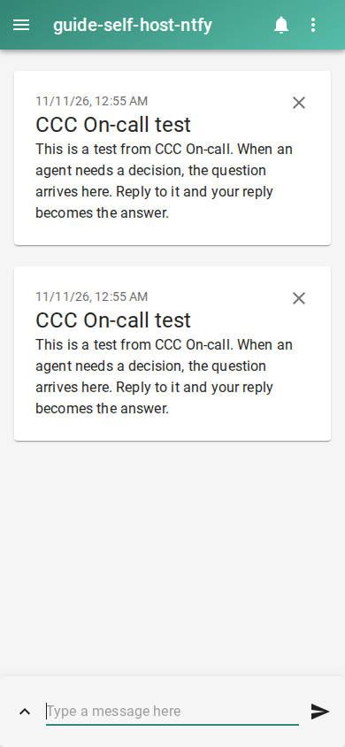

# Self-host coding agent notifications with ntfy

Run an ntfy server reachable from your computer and phone, then point On-call at it. Set `NTFY_SERVER` to its URL and `NTFY_TOPIC` to a private topic. Run from the code folder agents should fix:

```console checked
$ ccc oncall setup --yes --queue SHOP --repo . \
    --channel ntfy --set server="$NTFY_SERVER" \
    --set topic="$NTFY_TOPIC"
On-call is on: alerts and replies are enabled. Turn it off: ccc oncall off
```

```console checked
$ ccc oncall test ntfy
ntfy: sent.
```

## What you will see

Subscribe to the printed server and topic in the ntfy app. You should see a test message. Replies go to the separate topic ending in `-reply`, with the alert number before your answer.



## Limits

A loopback server works only on the same machine. Your phone needs a reachable address. Keep topic names private and configure ntfy access controls as needed. This guide does not set up remote networking or TLS termination. Server acceptance does not prove phone display.

## How we checked this

The setup and test commands ran against pinned local ntfy. Puppeteer subscribed through its real web app at phone size and captured the received message. The full protocol proof also checks reply routing.

[Run the guide checks and see prerequisites](README.md#repeat-the-checks).
