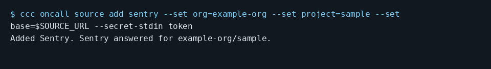

# Send Sentry errors to a coding agent

Add a Sentry source with the organization, project and an event:read token. This checked configuration uses an empty local API fixture and the fake stdin value test-only.

```console checked
$ ccc oncall source add sentry --set org=example-org --set project=sample --set base=$SOURCE_URL --secret-stdin token
Added Sentry. Sentry answered for example-org/sample.
```



Terminal capture rendered from the checked output above, with lines wrapped.

## What you will see

The CLI validates the source and stores the token in the local vault. The monitoring adapter looks for new unresolved issues.

## Limits

This checks configuration only, not an actual Sentry error or a resulting agent fix. Source tests cover issue filtering and baselining. Existing unresolved issues are not filed by default.

## Not run here: needs a real account

In Settings > On-call, add Sentry. Supply your organization and project slugs and a token with event:read scope. Leave the default server address for hosted Sentry. Choose an environment filter and minimum event count if needed. No hosted Sentry account was contacted here.

[Guide setup and verification](README.md)
