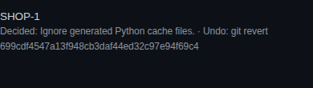

# Stop coding agents asking about small reversible decisions

Try the demo and answer `zero`, then `yes`. Its final scene records a minor decision and prints its undo. Then enable the same policy on your queue.

```console checked
$ ccc oncall demo
Agent: Fix committed locally. The test passes.
```

Run these from the code folder you want agents to fix, with CCC and WatchTower installed and the dashboard running. Set `NTFY_SERVER` to your ntfy server URL and `NTFY_TOPIC` to a private topic name. Subscribe to that server and topic in the ntfy app. The setup command enables the preview and On-call; it also configures a worker for this folder.

```console checked
$ ccc oncall setup --yes --queue SHOP --repo . \
    --channel ntfy --set server="$NTFY_SERVER" \
    --set topic="$NTFY_TOPIC"
On-call is on: alerts and replies are enabled. Turn it off: ccc oncall off
```

```console checked
$ ccc oncall minor on
Agents now decide small reversible things and keep going. Money, messages to customers, public posts and anything that cannot be undone still come to you.
```

```console checked
$ ccc oncall decisions
  Decided: Ignore generated Python cache files.
```

## What you will see

The list shows what the agent recommended, its undo instructions and whether it was applied. In the local example the decision is to ignore generated Python cache files. Follow the recorded undo command if you want to reverse a real decision.



## Limits

There is no generic On-call undo command. The policy covers small reversible code changes, not money, customer sends, public posts or irreversible actions. Production changes are not minor. The policy does not restrict the engine’s tool access.

## How we checked this

The exact commands ran against a real isolated queue. The checker seeded a real minor decision through WatchTower, then read it through the CLI. After the capture it ran the recorded git revert and checked that the cache-ignore file was removed. The demo exercised a real local cache-ignore commit. The image is the actual On-call decisions list, backed by that queue.

[Run the guide checks and see prerequisites](README.md#repeat-the-checks).
