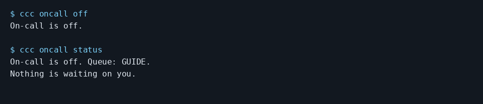

# Stop coding agent notifications while you work

Turn On-call off and check the state:

```console checked
$ ccc oncall off
On-call is off.
```

```console checked
$ ccc oncall status
On-call is off. Queue: GUIDE.
Nothing is waiting on you.
```



Terminal capture rendered from the checked output above, with lines wrapped.

## What you will see

The saved On-call setting changes to off. The checker confirms the CLI
reads that state back from the real local API.

## Limits

This stops On-call monitoring and notifications. It does not stop agents
already running or disable a WatchTower queue's auto-drain. It does not
revoke a message that has already been sent. Re-enable On-call through
Settings > On-call after checking the queue and channel configuration.

[Guide setup and verification](README.md)
