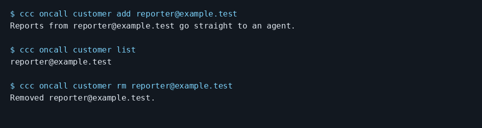

# Let known customers report bugs without approving every report

Add one trusted address, inspect it, and remove it when needed:

```console checked
$ ccc oncall customer add reporter@example.test
Reports from reporter@example.test go straight to an agent.
```
```console checked
$ ccc oncall customer list
reporter@example.test
```
```console checked
$ ccc oncall customer rm reporter@example.test
Removed reporter@example.test.
```



Terminal capture rendered from the checked output above, with lines wrapped.

## What you will see

The address enters and then leaves the trusted list. The email proof separately exercises intake from a trusted reporter.

## Limits

Trust controls whether a report can become work. It does not approve outgoing messages. Unknown reporters are held for go or no. A domain-wide entry trusts everyone at that domain; prefer individual addresses when that is too broad.

[Guide setup and verification](README.md)
