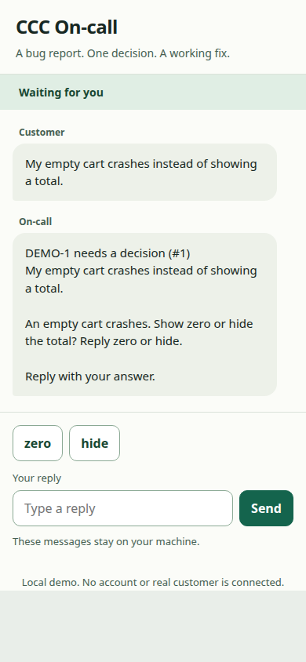

# Try coding agent bug fixes without an account

Run the demo. When it asks, type `zero`, then `yes`. Its messages stay on your machine. No dashboard, Docker, phone or account is needed.

```console checked
$ ccc oncall demo
Agent: Fix committed locally. The test passes.
```

## What you will see

A customer reports an empty-cart crash. You answer one question. The worker fixes the sample, runs its test and commits. You approve a local reporter notice. The last scene shows a small decision and how to undo it.



## Limits

The default worker is scripted, not a model. With WatchTower installed it uses a real private queue; otherwise it labels its ticket fixture. No changes reach your own repository. The real setup is a separate action.

## How we checked this

The exact demo command ran with terminal replies zero and yes. The capture shows the real local demo phone while it waited for the first answer. The regression test failed before the change and passed afterward.

[Run the guide checks and see prerequisites](README.md#repeat-the-checks).
